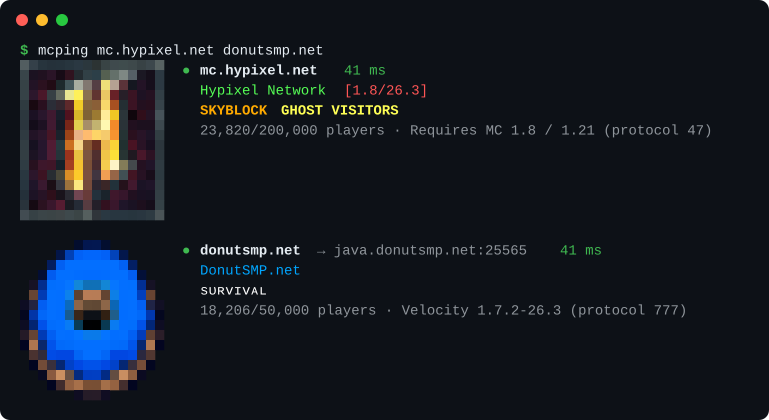

# mcping

Ping Minecraft Java servers from your terminal.



- The server icon drawn next to the output with truecolor half blocks
- MOTDs in their real colors (legacy `§` codes, chat components and hex colors)
- Pings any number of servers at once
- Follows `_minecraft._tcp` SRV records like the game does
- Real latency from the ping/pong packets, not just the TCP connect time
- `--json` output for scripts, and a non-zero exit code when a server is down

The protocol is written by hand (VarInts, handshake, status and ping packets), so the only network dependencies are Tokio and a DNS resolver.

## Install

Linux and macOS:

```
curl -fsSL avynnx.dev/mcping/install.sh | sh
```

Windows:

```
winget install avynnx.mcping
```

Nix:

```
nix run github:avynnx/mcping -- mc.hypixel.net
```

With Cargo:

```
cargo install --git https://github.com/avynnx/mcping
```

The install script puts `mcping` in `~/.local/bin`. Set `MCPING_INSTALL_DIR` to change that, or `MCPING_VERSION=v0.1.0` to pin a version.

## Usage

```
mcping <SERVER>...

  -t, --timeout <SECS>   per-server timeout [default: 5]
      --json             print JSON instead
      --no-icon          don't draw the server icon
      --icon-size <PX>   icon size in pixels, 2-64 [default: 16]
```

Servers can be `host`, `host:port`, an IP or `[ipv6]:port`. Colors and icons turn off when output isn't a terminal or `NO_COLOR` is set, and `CLICOLOR_FORCE=1` keeps them on.

```
mcping play.example.net 10.0.0.5:25570 --json | jq '.[] | {server, latency_ms}'
```

## License

MIT
